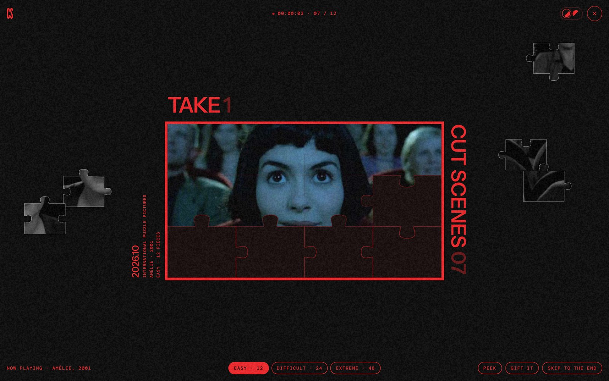
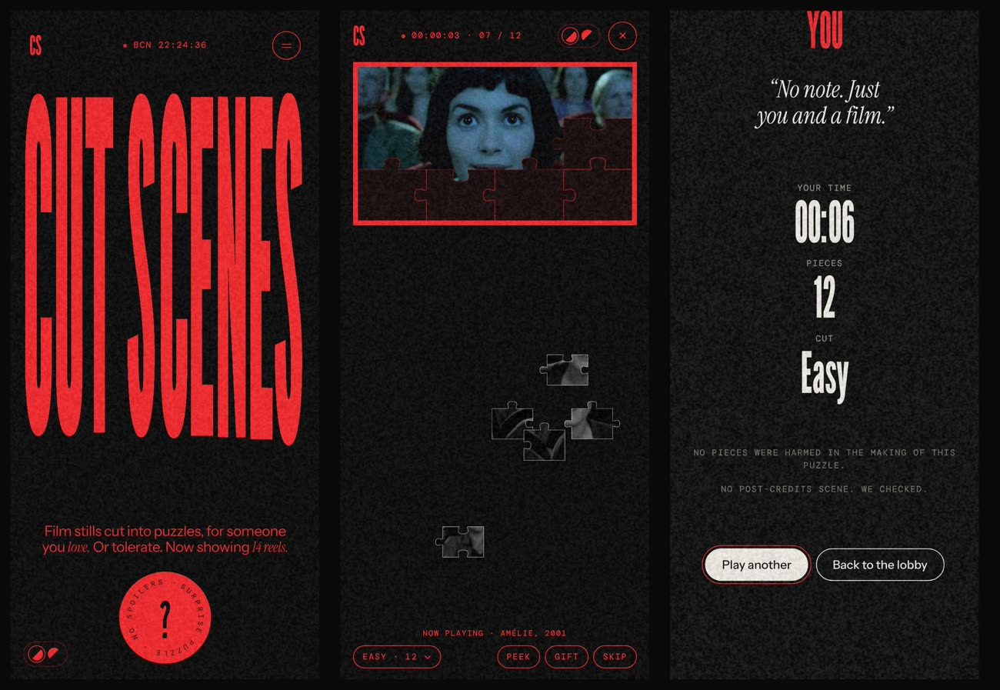
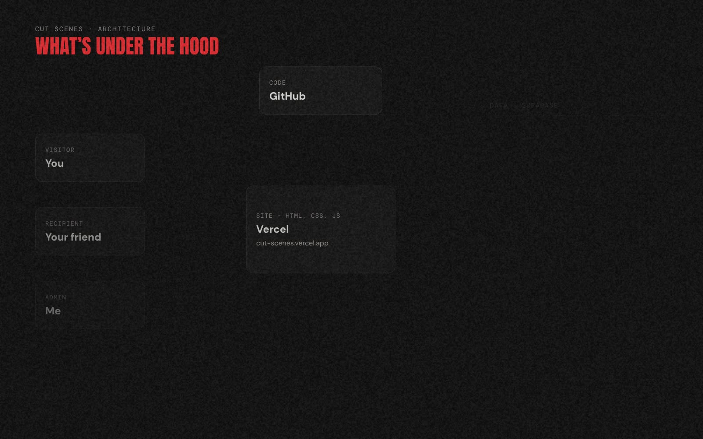
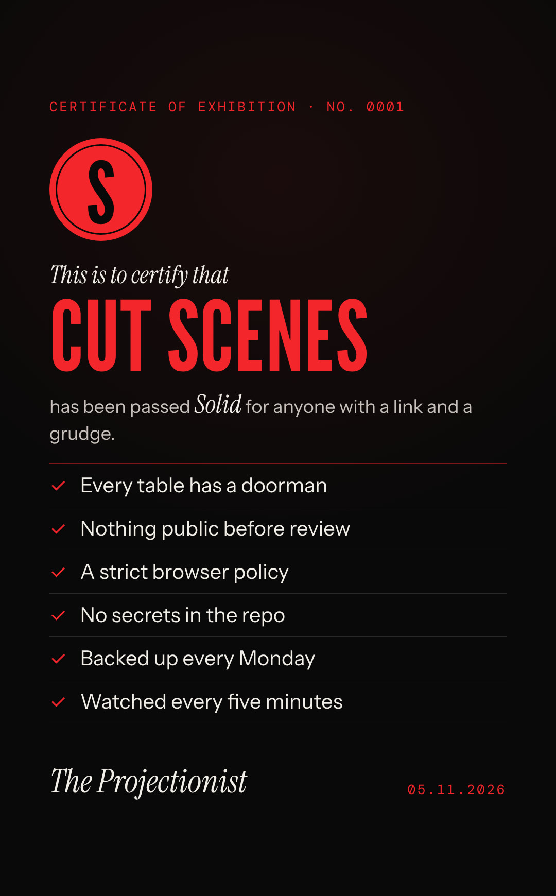

# Cut Scenes

**Film stills cut into puzzles, made to gift.** Send a scene to a friend, or the film you're watching together tonight. When the last piece lands, the credits roll.

**[cut-scenes.vercel.app](https://cut-scenes.vercel.app)** · A personal design exploration by [Álida Díaz de Freijo](https://alidadiazdefreijo.framer.website/), built in pair with Claude.





## What it does

- **Now Showing.** A catalogue of film and TV stills, each with credits and one line of opinion.
- **Three cuts.** Easy (12 pieces), Difficult (24) and Extreme (48, with no outlines).
- **Surprise puzzle.** Pick nothing and get a scene you don't know yet.
- **Gift it.** Send a scene with a note and a ticket link. Whoever opens it sees the site in reverse: black on red.
- **Make your own.** Use your own still. It goes out as a gift straight away and only joins the catalogue after review.
- **Credits.** The film's details roll at the end, with its song through Spotify if you've cued the music.
- **Speed board.** The fastest times for each film and cut.
- **Projection room.** A private review queue for everything people submit.

## How it's built



| Piece | Job |
|---|---|
| **HTML, CSS and JavaScript** | The whole site, with no framework and no build step. The puzzle is cut and played in the browser. |
| **Vercel** | Hosting, HTTPS, security headers and analytics. Every push to `main` goes live in about a minute. |
| **Supabase** | Postgres database, image storage and the admin login. The database decides who can do what. |
| **GitHub Actions** | The night shift: keeps the database awake, takes a weekly encrypted backup and runs a monthly clean-up. |
| **TMDB · Spotify** | Film details and stills for the catalogue, and the song that plays over the credits. |

```
index.html          the page
privacy.html        privacy policy
css/                styles
fonts/              self-hosted fonts
js/app.js           puzzle engine, flows, credits
js/db.js            every call to Supabase, in one place
js/config.js        Supabase URL and public key
js/vendor/          supabase-js, self-hosted
stills/ thumbs/     catalogue images and their light WebP copies
icons/              favicons and the TMDB logo
supabase/           database schema and numbered migrations
tools/              TMDB import script
.github/workflows/  keepalive, backup, cleanup
vercel.json         security headers
docs/               database, operations and README images
```

## Why it holds



- **The doorman lives in the database.** Row Level Security is on every table. The public key in `js/config.js` is meant to be public: it only opens what the rules allow. Gift links can't be listed, only opened by their code.
- **Nothing goes on screen without review.** Uploads wait in a queue. Uploads, gift links and scores have hourly limits. Images must be under 5 MB, rude names bounce and impossible times don't count.
- **The browser is on a short leash.** A Content-Security-Policy lets the page load only its own files, Supabase and Spotify. There are no inline scripts and no framing.
- **Photos lose their secrets.** Uploads are redrawn in a canvas before they leave the browser, which strips location and camera data.
- **Someone works the night shift.** An encrypted backup runs every Monday. Gifts older than a year are deleted, as the privacy policy promises. An alarm goes off if the site stops answering.

More in [docs/operations.md](docs/operations.md), including what to do if something goes wrong.

## Decisions worth explaining

- **No framework.** It's one page with a lot of motion and very little state. Plain JavaScript keeps it fast, keeps the build step at zero and leaves every line readable.
- **No server of my own.** Supabase's rules do the job a backend would, so there's nothing to patch at 3 a.m.
- **Music only after a click.** Spotify sets its own cookies, so it never loads until you ask for it. Its player also needs `'unsafe-eval'` to autoplay and loop. I kept the music and wrote the exception down.
- **Your gift goes out immediately, the catalogue waits.** A gift reaches one person, so it goes now. The catalogue reaches everyone, so it waits for review.

## Run it locally

```
python3 -m http.server 8000
```

Open http://localhost:8000. Shared links and uploads need a real address, so serve the folder instead of opening the file. To set up your own database, see [docs/database.md](docs/database.md).

## Credits and license

The **code** is released under the [MIT License](LICENSE).

**Film stills** belong to their studios and filmmakers and are used for a non-commercial exploration. They are not covered by the license. Film data and images come from [TMDB](https://www.themoviedb.org). This product uses the TMDB API but is not endorsed or certified by TMDB. Fonts are under their own licenses (SIL Open Font License).
